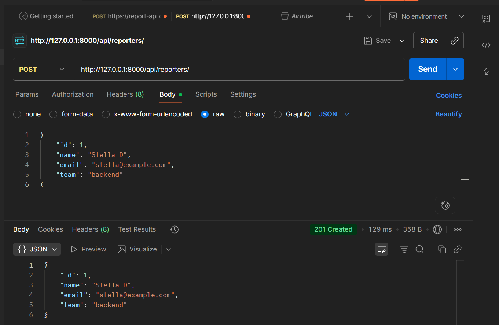
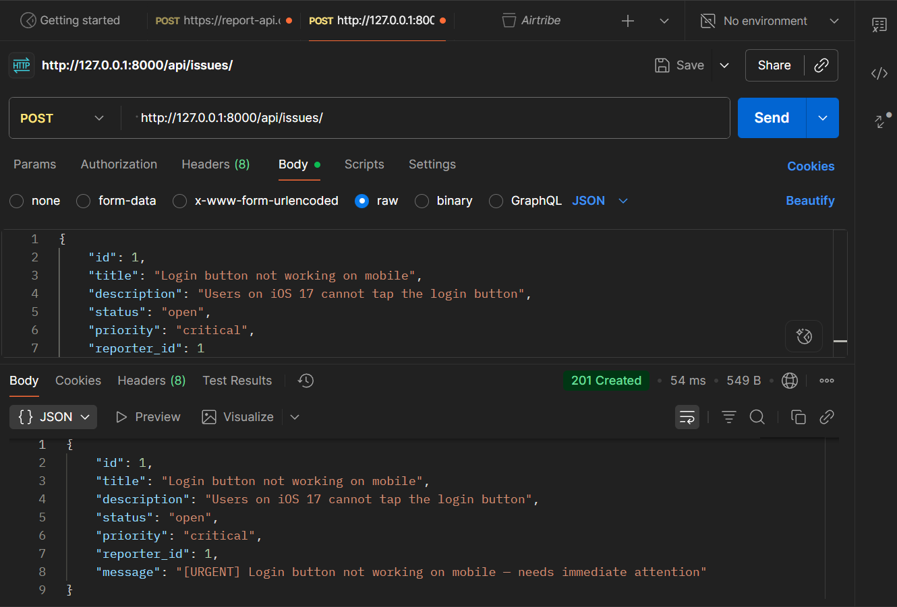
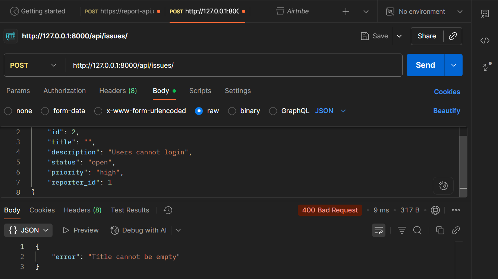

# DevTrack

DevTrack is a small Django backend API for tracking software issues and the people (reporters) who file them. It is an educational project focused on Python OOP (inheritance, method overriding, abstract base classes), Django routing, validation, and JSON-file persistence. No database is used.

## How to run

```bash
python -m venv venv
venv\Scripts\activate
pip install django
python manage.py runserver
```

On macOS / Linux, activate with `source venv/bin/activate` instead.

The API is served at `http://127.0.0.1:8000/api/`.

## Endpoints

### Reporters

| Method | URL | Description |
|--------|-----|-------------|
| POST | `/api/reporters/` | Create a reporter |
| GET | `/api/reporters/` | List all reporters |
| GET | `/api/reporters/?id=1` | Get one reporter by id |

`POST /api/reporters/`

```json
{ "id": 1, "name": "Stella D", "email": "stella@example.com", "team": "backend" }
```

Response `201`:

```json
{ "id": 1, "name": "Stella D", "email": "stella@example.com", "team": "backend" }
```

Validation error `400`: `{ "error": "Name cannot be empty" }`
Not found `404`: `{ "error": "Reporter not found" }`

### Issues

| Method | URL | Description |
|--------|-----|-------------|
| POST | `/api/issues/` | Create an issue |
| GET | `/api/issues/` | List all issues |
| GET | `/api/issues/?id=1` | Get one issue by id |
| GET | `/api/issues/?status=open` | List issues with a status (`open`, `in_progress`, `resolved`, `closed`) |

`POST /api/issues/`

```json
{
  "id": 1,
  "title": "Login button not working on mobile",
  "description": "Users on iOS 17 cannot tap the login button",
  "status": "open",
  "priority": "critical",
  "reporter_id": 1
}
```

Response `201`:

```json
{
  "id": 1,
  "title": "Login button not working on mobile",
  "description": "Users on iOS 17 cannot tap the login button",
  "status": "open",
  "priority": "critical",
  "reporter_id": 1,
  "message": "[URGENT] Login button not working on mobile — needs immediate attention"
}
```

Errors: `400` for invalid JSON, missing fields, validation failures (`{ "error": "Title cannot be empty" }`), non-integer ids or an invalid status filter; `404` for an unknown issue or unknown `reporter_id`; `405` for unsupported methods.

## OOP design

All classes live in `issues/models.py`.

- **`BaseEntity`** – abstract base class (`ABC`). Declares the abstract `validate()` and provides a shared `to_dict()` that returns the object's attributes as a dict.
- **`Reporter(BaseEntity)`** – `id`, `name`, `email`, `team`. `validate()` rejects an empty name and an email without `@`.
- **`Issue(BaseEntity)`** – `id`, `title`, `description`, `status`, `priority`, `reporter_id`. `validate()` rejects an empty title and any status/priority outside the allowed values. `describe()` returns `"<title> [<priority>]"`.
- **`CriticalIssue(Issue)`** and **`LowPriorityIssue(Issue)`** – subclasses of `Issue` that *override* `describe()` to return an urgent / low-priority message.
- **Inheritance & overriding** – the view picks the right class from the priority, then calls `issue.describe()`; Python's polymorphism chooses the correct message, so there are no conditionals inside `Issue.describe()`.
- **`validate()`** raises `ValueError` with a helpful message; views turn it into a `400` response.
- **`to_dict()`** converts an entity into a plain dict that is saved to JSON and returned in responses.

The relationship is one Reporter → many Issues, stored only as `reporter_id` on each Issue.

## Design decision

JSON files were used instead of a database because the assignment explicitly requires file-based persistence. This keeps the implementation simple and allows the focus to remain on Python OOP, Django routing, validation, and API development. File paths are built from `Path(__file__)`, so the app works regardless of the current working directory.

## Postman testing

Screenshots are in the `screenshots/` folder.

**Successful request – create reporter** (`POST /api/reporters/` → `201 Created`):



**Successful request – create critical issue** (`POST /api/issues/` → `201 Created`, with the `[URGENT]` message from `CriticalIssue.describe()`):



**Failed request – validation error** (`POST /api/issues/` with an empty title → `400 Bad Request`):


